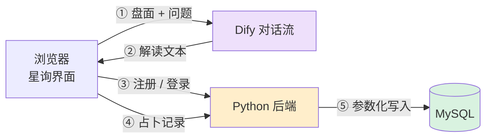

# 星询 · 多方法占卜助手

一个能对话的占卜助手：支持六种占卜方法，能记住每一局的盘面，能被追问，还能把结果落进数据库。

> 这不是一个「接了个大模型的玩具」。它解决的是**多轮对话里的状态管理**——
> 盘面怎么存、追问怎么接、参数缺了怎么补、数据写到哪里去。这些才是真正花时间的地方。

## 架构



三条链路彼此独立：

- **解读链路**：浏览器把盘面交给 Dify，拿回一段文字。Dify 不碰数据库。
- **账号链路**：密码只走 Python 后端，PBKDF2 加盐哈希后入库。
- **存储链路**：占卜结果由前端在拿到解读后写入，后端负责校验身份。

## 技术栈

| 层 | 用什么 |
| --- | --- |
| 对话编排 | Dify 1.18（Chatflow） |
| 后端 | Python 3.12 + 标准库 `http.server` + PyMySQL |
| 数据库 | MySQL 8.0 |
| 前端 | 单文件 HTML + 原生 JavaScript |

## 六种方法

| 方法 | 怎么起盘 | 依赖 |
| --- | --- | --- |
| 塔罗 | 78 张牌随机抽三张 | 无 |
| 六爻 | 三枚铜钱投六次，定本卦与变卦 | 无 |
| 八字 | 儒略日 + 节气近似表算四柱 | 出生日期（时柱可选） |
| 紫微 | 命宫→五行局→十四主星→四化→大限 | 农历生日 + 时辰 |
| 黄历 | 日柱→建除十二神→宜忌表 | 日期（默认今天） |
| 星座 | 月日→太阳星座区间表 | 出生月日 |

## 快速开始

**1. 装依赖**

```bash
pip install -r backend/requirements.txt
```

**2. 配置**

复制 `.env.example` 为 `.env`，填数据库和密钥：

```
XINGXUN_DB_HOST=127.0.0.1
XINGXUN_DB_USER=root
XINGXUN_DB_PASSWORD=你的密码
XINGXUN_DB_NAME=divination_simple
XINGXUN_TOKEN_SECRET=换成一串随机字符
```

**3. 起服务**

```bash
cd backend
python web_app.py
```

首次启动会自动建库、建表、补字段、造演示账号（`demo` / `tarot2026`）。

访问 `http://127.0.0.1:8000` 是自带的测试台，`/api/health` 可以探活。

**4. 导入对话流**

见 [`dify/README.md`](dify/README.md)。

## 目录

```
backend/          Python 后端：HTTP 服务 + 数据库工具
  server.py       连接、建表、取 user_id
  web_app.py      路由、认证、历史记录
  sql/            建表与常用查询
dify/             对话流 DSL 与导入说明
docs/             设计文档（复盘 + 代码导读）
frontend/         前端产物说明
```

## 已知限制

诚实写在这里，免得别人踩坑：

- **排盘是简化版**：八字未含真太阳时与精确节气；紫微未排辅星与神煞；星座只算太阳，不含月升
- **没有 TLS**：演示阶段走 http，密码在局域网内是明文传输
- **密码哈希是全局固定盐**：规范做法应为每个用户随机盐
- **单进程服务**：`http.server` 没有连接池，并发高会成为瓶颈
- **历史接口按令牌隔离**，但没有频率限制，可以无限尝试

## 设计文档

- [`docs/`](docs/) — 项目复盘：八次返工的现象、根因、修法和取舍
- 对话流代码：十个代码节点的逐段讲解

## 许可

MIT
